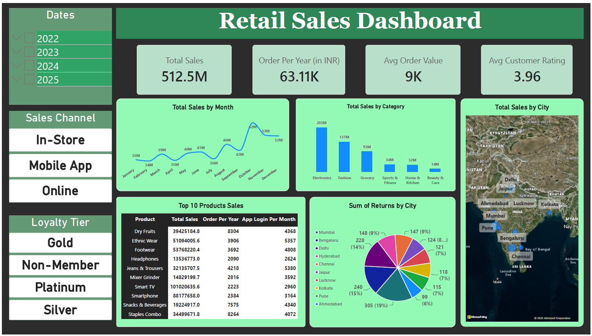

# 🛍️ Retail Sales Dashboard

## 📸 Dashboard Preview

## 📌 Project Overview
This project analyzes retail sales data to uncover key business insights.  
The dashboard highlights **sales trends, category performance, customer behavior, and regional returns**, helping stakeholders make data‑driven decisions.

---

## 🛠 Tools Used
- **Power BI** (dashboard creation, KPIs, visuals)
- **Excel** (data cleaning, pivot tables)
- **SQL** (data queries and schema design)
- **Python (pandas, matplotlib, seaborn)** (exploratory analysis)
- **Tableau / Google Sheets** (optional visualization)

---

## 📊 Key Metrics (KPIs)
- **Total Sales:** ₹512.5M  
- **Orders per Year:** 63.11K  
- **Average Order Value:** ₹9K  
- **Average Customer Rating:** 3.96  

---

## 📈 Dashboard Insights
- **Category Leaders:** Electronics (₹203M), Fashion (₹137M), Grocery (₹93M)  
- **Monthly Trends:** Strong Q1 performance (Jan–Feb), weaker Q4 (Oct–Dec)  
- **Top Products:** Smart TV (₹101M), Smartphone (₹88M), Footwear & Ethnic Wear  
- **Regional Returns:** Highest in Ahmedabad (19%) and Kolkata (15%)  
- **Customer Behavior:** Staples & Dry Fruits show high repeat demand  

---

